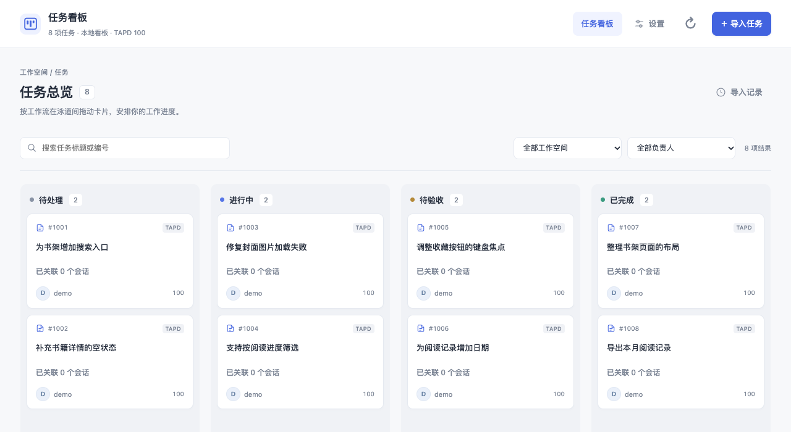
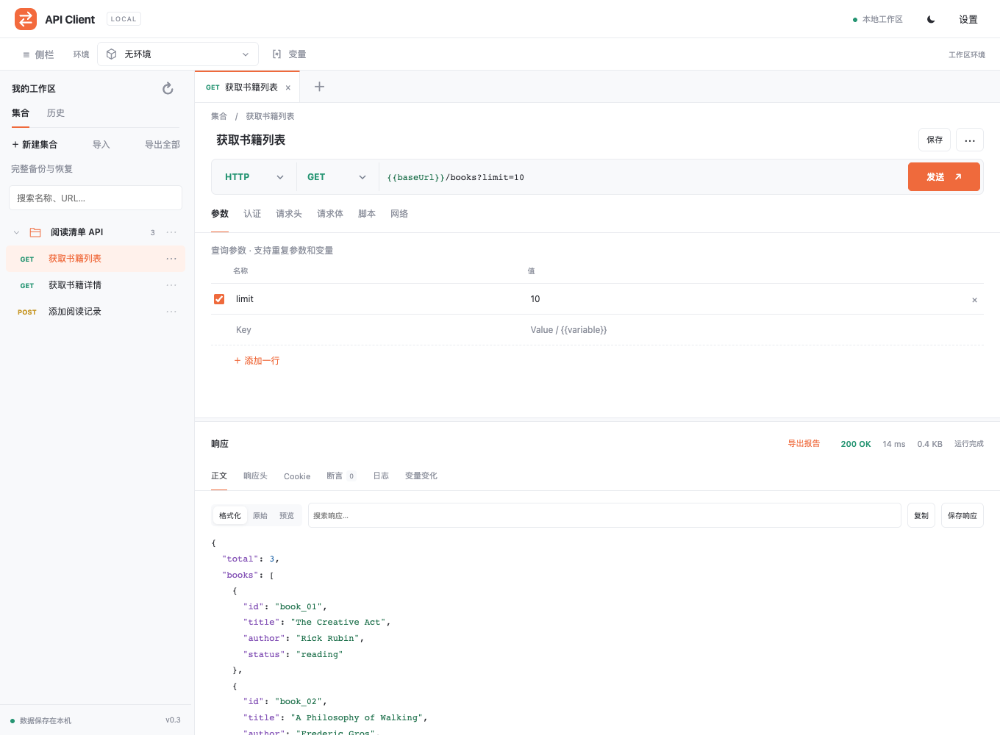
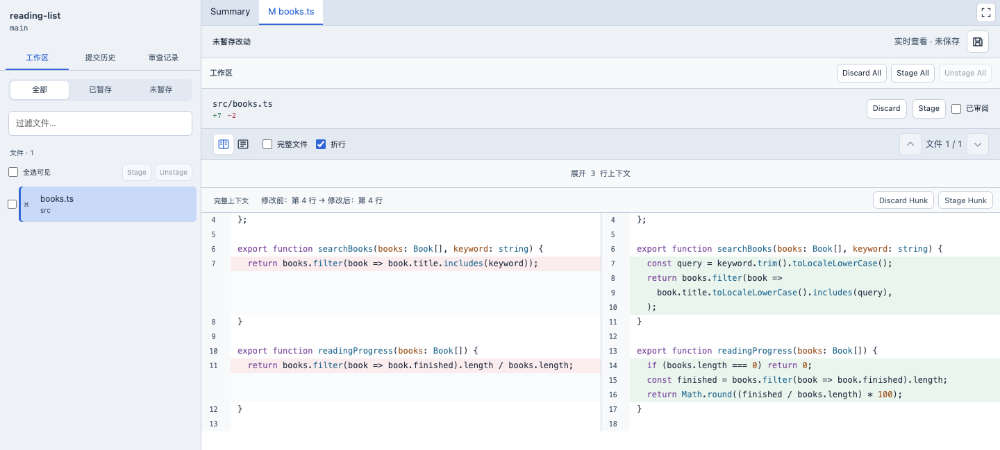

# Codex 插件集

我自己在用的几个 Codex 插件：排任务、调接口、看代码、查数据库。装好后从 Codex 左侧打开，需要哪个就装哪个。

**[开始安装 ↓](#快速开始)** · [看看界面](#选择插件) · [报告问题](#问题与建议) · [更新记录](CHANGELOG.md)

<picture>
  <source media="(prefers-color-scheme: dark)" srcset="docs/assets/readme/task-panel-dark.png">
  
</picture>

<sub>任务看板。下方截图也来自实际插件界面，使用虚构的阅读清单项目和演示数据。</sub>

## 快速开始

准备好 **macOS、Node.js ≥22.13、Git，以及已登录的 Codex 桌面版和 CLI**。CLI 需支持 `codex plugin`，桌面版需支持 MCP Apps，`node` 和 `codex` 需在桌面应用能继承的 PATH 中。DBX 还需要先启动 Docker。

```sh
git clone https://github.com/skyfour/my_codex_plugin.git
cd my_codex_plugin
```

选择需要的插件，运行对应命令：

| 插件 | 安装命令 |
| --- | --- |
| [任务看板](plugins/codex-task-panel/README.md) | `npm run install:task-panel` |
| [API 调试台](plugins/codex-api-client/README.md) | `npm run install:api-client` |
| [本地代码审查](plugins/codex-local-review/README.md) | `npm run install:local-review` |
| [DBX 数据库工作台](plugins/dbx/README.md) | `npm run install:dbx` |

任务看板导入需配置 TAPD 工作空间、账户完整姓名和 Access Token。API 调试台使用 macOS Keychain 保存敏感值。DBX 安装前先确认 `docker info` 正常，首次安装会拉取官方镜像。

安装脚本会准备依赖、构建和检查，再注册所选插件。完成后**重新打开 Codex 并新建聊天**，确认插件已启用，点击左侧图标即可使用。反馈技能随插件一起安装。

[完整安装步骤与首次使用 →](docs/installation.md#快速开始)

## 选择插件

### 任务看板

从 TAPD 挑选任务导入，拖到对应泳道，再关联处理它的 Codex 会话。进度保存在本机，不回写 TAPD。上方是看板界面。

[使用任务看板 →](plugins/codex-task-panel/README.md)

### API 调试台

保存请求和环境，发送接口，看响应。可以导入 Postman 集合和 cURL、写请求前后脚本；还支持 WebSocket、SSE 等协议调试。请求从本机发出。

<picture>
  <source media="(prefers-color-scheme: dark)" srcset="docs/assets/readme/api-client-dark.png">
  
</picture>

[使用 API 调试台 →](plugins/codex-api-client/README.md)

### 本地代码审查

打开项目查看工作区差异或提交历史，在代码行上留批注、保存审查记录。也可以暂存改动、提交和同步分支。Git 与 SSH 认证沿用本机配置。

<picture>
  <source media="(prefers-color-scheme: dark)" srcset="docs/assets/readme/local-review-dark.png">
  
</picture>

[使用本地代码审查 →](plugins/codex-local-review/README.md)

### DBX 数据库工作台

在 Codex 侧栏打开完整的[官方 DBX Web 工作台](https://github.com/t8y2/dbx)，管理连接、编写 SQL、查看结果。本仓库提供 Codex 入口和本机 Docker 服务管理，DBX 本体可以单独更新。安装阶段会完成服务准备，打开侧栏后设置首次密码、添加连接即可。

[使用 DBX →](plugins/dbx/README.md)

## 安装与更新

回到首次克隆的仓库，拉取代码，再重装需要更新的插件。例如更新代码审查：

```sh
git pull --ff-only
npm run install:local-review
```

完成后重开 Codex 并新建聊天。安装和更新会保留已有本机数据；**只拉取代码不会更新已安装实例**。DBX 本体更新使用 `npm run update:dbx`。

[批量选择、DBX 恢复与数据迁移 →](docs/installation.md#安装与更新)

## 问题与建议

在 Codex 里描述遇到的情况即可，例如：

> 帮我给 API 调试台提交 issue：导入集合后，有一条请求的参数丢失了。

反馈技能会整理版本、复现步骤和预期结果。有 GitHub 连接时可按你的指令提交；没有连接时会给出草稿和表单链接。提交前请移除凭据、业务数据和私人路径。

[报告问题](https://github.com/skyfour/my_codex_plugin/issues/new?template=bug_report.yml) · [提出建议](https://github.com/skyfour/my_codex_plugin/issues/new?template=feature_request.yml) · [已有反馈](https://github.com/skyfour/my_codex_plugin/issues)

维护者可用 GitHub 通知／邮件接收反馈，在仓库里说“查看插件反馈”，或运行 `npm run issues`。设置方式和处理流程见[反馈与维护说明](docs/feedback.md)。

## 常见问题

[安装后没有入口、仍显示旧版、Docker 准备失败，以及换电脑迁移 →](docs/installation.md#常见问题)

## 开发与验证

准备依赖、运行测试和维护截图的方法见[开发说明](docs/development.md)。[安装、更新与迁移](docs/installation.md)保留了完整操作步骤。

[任务与提交联动](docs/task-commit-context.md) · [审阅界面](docs/review-surface.md) · [Git 工作台](docs/git-workbench.md) · [维护约定](AGENTS.md) · [GitHub Releases](https://github.com/skyfour/my_codex_plugin/releases)
