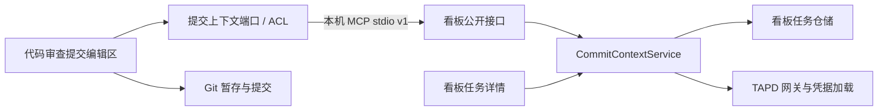

# 任务看板与代码审查的领域边界

任务看板是任务上下文的提供方；代码审查是使用方。二者各自维护业务模型，通过发布的提交上下文 v1 契约协作，不共享数据库表、凭据格式或领域对象，也不互相导入源码。Git 提交规则仍由代码审查的 Git 模块负责。

## 各层职责

| 模块 | 职责 |
| --- | --- |
| 看板 `CommitContextService` | 编排任务读取、缓存命中、缺失关键字获取与保存；依赖仓储、凭据和来源网关端口 |
| 看板 `BoardStore` / TAPD 客户端 / credentials | 仓储和外部服务适配器；这些实现和数据格式不向审查暴露 |
| 看板 `servers/commit-context.mjs` | 发布最小集成接口，不暴露泳道修改、任务导入、凭据读写能力 |
| 审查 `TaskContextProvider` | 实现审查所需的 `listTasks()`、`getCommitContext(taskId)` 端口；验证 v1 DTO，翻译为审查 UI 数据结构 |
| 审查 `git-commit.mjs` | HEAD、分支、暂存树检查与本地 Git commit；不依赖看板或 TAPD |

端口通过构造参数注入，可在测试中替换。没有引入共享领域包；消费者只维护自己使用的公开 DTO 校验和映射。这是公开宿主协议的依赖，不是对提供方内部模型的依赖。

## 公开契约 v1

使用 MCP stdio。接口版本独立于插件发布版本，不为了每次实现调整增加协议版本。破坏性变更需要新契约并保留迁移安排。

- `task_context_list {}` → `{contractVersion:1,tasks:[{taskId,title,source:{workspaceId,objectId},state,keyword}]}`，最多 2000 项。关键字可以为空。不加载凭据、不请求 TAPD。不返回正文、负责人、令牌或数据库路径。
- `task_commit_context {taskId,refresh?:boolean}` → `{contractVersion:1,taskId,title,keyword}`。默认复用看板保存的关键字；为空时由看板获取并缓存。`refresh:true` 强制刷新，失败保留旧关键字。未知任务返回错误。
- 失败使用 MCP `isError`、安全的中文提示及结构化 `code`；客户端不展示底层进程诊断，也不会自行拼接关键字。

## 本机发现与生命周期

安装器在安装看板后运行**安装缓存内**的接口入口 `--register`，原子写入 `${CODEX_HOME:-~/.codex}/integrations/task-commit-context-v1.json`。启动看板也会登记。该文件仅包含 `contractVersion`、`transport` 和绝对 `entrypoint`，不是任务数据，也不含凭据。审查不猜测看板缓存版本、不访问开发目录、不搜索数据库。

审查每次调用创建短生命周期的看板 MCP 子进程，初始化后调用一个接口，随后关闭。初始化与请求共用 30 秒超时；异常时也关闭进程，必要时由 stdio 传输结束子进程。不监听 HTTP 端口，不增加常驻服务。子进程环境由宿主转交：`CODEX_HOME`、`TASK_PANEL_HOME`、`TAPD_ACCESS_TOKEN` 保留旧安装的环境令牌兼容性；审查只转发环境，令牌解释和凭据优先级只由看板实现。接口返回值不包含令牌。两边可共享同一个数据目录，但只有看板访问其中的任务数据。

未安装、旧版接口、路径失效或协议不兼容时，关联入口显示更新看板提示，普通 Git 提交仍可使用。安装或更新任务看板后无需先打开任务详情。单独更新审查不会自动更新看板，正式发布需协调两个插件。

## 用户操作与一致性

选择任务后获取上下文、显示完整源码关键字与 message；空说明自动填入任务标题，已有说明不变。「应用到提交说明」用当前任务的完整关键字覆盖整段说明。消费者原样使用 TAPD 返回的信息，不另加标题或链接。提交预览与实际提交都使用编辑区文字（去除首尾空白），提交时不再拼接关键字；关联提交只核对任务类型、编号和工作区标识（如 `--task=123@tapd-100`），允许修改标题、正文和用户信息；缺少当前任务标识时提示补回标识或取消关联。切换或取消任务、关键字更新不修改已有说明。手工输入相同完整关键字的独立一行同样可提交。获取失败保留草稿并提供重试。看板中「从 TAPD 获取」强制刷新。

代码审查仅缓存本次选择的上下文，确认提交时要求 message 含有已预览关键字中的任务标识，允许各次提交使用不同阶段说明。Git 原有 HEAD、分支、暂存树与 hooks 检查保持独立。只提交用户暂存的文件，不自动 Stage、push 或回写 TAPD 状态；本地提交后的 TAPD 关联仍依赖项目的源码集成和 Webhook。

## 验证

`npm test` 包含提供方业务测试、消费方 ACL 测试和真实隔离 stdio 契约测试（默认与自定义数据目录、离线缓存、缺少凭据、未知任务和失效入口）。`npm run test:local-review-ui` 验证任务选择、失败重试、完整 message 预览和只提交暂存内容；`npm run test:task-panel-ui` 验证看板原有交互。
